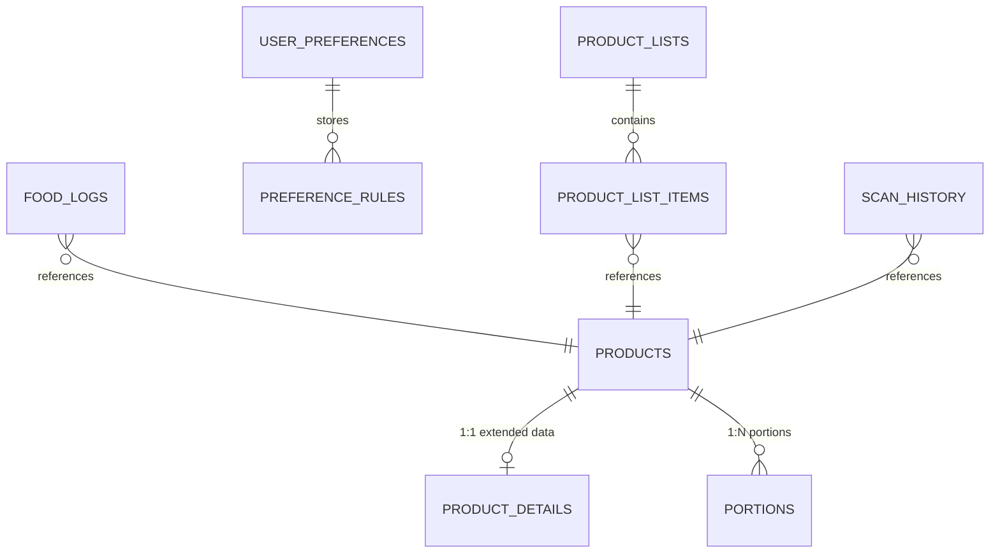

# Open Food Facts Feature Analysis & Glucio Integration Architecture

## 1. Executive Summary & Design Philosophy

Glucio (`com.glucio.app`) is an Android-first, offline-first health app whose signature identity is **translating sugar grams into plain-language teaspoons and physical 3D sugar cubes against the WHO 25g recommended daily limit**. This identity is the undisputed **hero** of the application and must remain the prominent visual and cognitive center of the user experience.

This document synthesizes our on-device audit of the official Open Food Facts (OFF) Android application running on physical hardware (Samsung Galaxy M31, `RZ8N702ND4E`) and provides an architectural blueprint for bringing OFF's product intelligence, nutritional quality scoring, personalization, comparison, and community contribution features into Glucio.

### Non-Negotiable Constraints & Principles

1. **Glucio Neo-Brutalist Design Integrity**:
   - Every new widget, badge, card, and modal strictly adheres to Glucio's Neo-Brutalist design tokens defined in `app/lib/core/theme/glucio_theme.dart`:
     - Chunky **2px solid ink black (`#111111`) borders**.
     - Hard **4px zero-blur drop shadows** (`Offset(4, 4)`).
     - Warm **cream background palette** (`bgCream: #FBF7E6`, `cardCream: #FFFDF5`).
     - Distinctive typography: **LilitaOne** for chunky display headers, **SpaceMono** for crisp monospace data.
   - Existing color tokens are preserved untouched. New tokens (Nutri-Score A–E, NOVA 1–4, Eco-Score A–E) are introduced in an isolated extension, tuned to harmonise with the cream/ink palette and always framed in black ink borders.
2. **Sugar Remains the Hero**:
   - The primary scan result screen displays the sugar hero sentence, 3D cubes, WHO gauge, hidden sugar alert, and portion selector instantly.
   - Extended OFF data (Nutri-Score, NOVA, ingredients, additives, nutrition facts, packaging) loads progressively below the sugar hero in collapsible Neo-Brutalist accordion cards without delaying or shifting the hero.
3. **Strict Null Safety & Honest Defaults**:
   - Missing Nutri-Score, NOVA, Eco-Score, allergens, additives, or nutrients are **never** rendered as `0`, `"A"`, or `"Safe"`.
   - Any missing attribute displays an explicit **"Not available"** neo badge or card, accompanied by a call-to-action into Glucio's "Add or correct product" flow.
4. **Three-Tier Offline-First Architecture**:
   - Product lookup hierarchy:
     1. Local SQLite cache (`product_details`).
     2. Bundled offline seed catalog (287+ staple Indian packaged products).
     3. Live Open Food Facts v2 API (authenticated custom User-Agent, filtered fields).
   - Any fetched OFF record is immediately written to local SQLite (`product_details` with `fetched_at` timestamp) so previously viewed products work 100% offline indefinitely.
5. **Quality & Test Coverage Assurance**:
   - All 72 existing unit, widget, and golden tests must remain green.
   - `flutter analyze` must maintain 0 warnings/errors.
   - Dedicated unit and widget tests are required for every new model, parser, provider, and UI component.
6. **OFF Terms of Use & Legal Attribution**:
   - Custom User-Agent header: `Glucio/1.0.0 (com.glucio.app; Android)`.
   - Official attribution displayed on product pages and Settings/About: *"Data from Open Food Facts, ODbL; images CC-BY-SA"*.

---

## 2. Open Food Facts Device Audit (Samsung Galaxy M31)

We conducted an in-depth audit of the official Open Food Facts app (`org.openfoodfacts.scanner`) on a connected Samsung Galaxy M31 device. Key screens, flows, and interactive components were captured and analyzed:

### 2.1 Screen-to-Purpose Map

| OFF Screen | Primary Purpose / Information Architecture | Key Interaction & Data Points Captured | Glucio Screenshot Evidence |
| :--- | :--- | :--- | :--- |
| **Home / Scanner** | Camera viewfinder for barcode scanning, quick search bar, recent scan previews, community prompt. | Viewfinder with torch/flash toggle, manual barcode entry, "Missing foods" contribute banner, 3 bottom tabs: *Community*, *Scan*, *Lists*. | `off_01_home.png` |
| **Product Detail - Overview ("For me")** | Product hero, user compatibility score, personal preferences summary. | Product thumbnail, title, brand, net quantity, Nutri-Score badge, Green-Score badge, user compatibility score (e.g. `15% compatible`), personal diet match status. | `off_biscuit_01.png`, `off_biscuit_02.png` |
| **Product Detail - Health Tab** | Comprehensive nutritional assessment and processing grade. | **Nutri-Score** banner with tap-to-expand sheet; **Nutrient levels 2x2 grid** (Fat, Sat Fat, Sugars, Salt) color-coded (Green/Orange/Red); **NOVA 4 Ultra-processed card** with additive chips (`E322`, `E500`, `E503`); Ingredients list with allergens highlighted. | `off_health_top.png`, `off_health_tab.png` |
| **Nutri-Score Detail Sheet** | Educational explanation of the Nutri-Score calculation. | Warning/disclaimer card; Negative points breakdown per 100g (Energy, Sugar points e.g. `9/15`, Saturated Fat, Salt); Positive points breakdown (Fiber e.g. `1/5`, Fruits/Veg `0/5`); Link to official algorithm documentation. | `off_nutriscore_sheet.png`, `off_nutriscore_sheet_bottom.png` |
| **NOVA Detail Sheet** | Processing classification breakdown. | Health risk statement regarding ultra-processing; Markers of ultra-processing detected in product (flavorings, emulsifiers, modified starches); Definitions of NOVA groups 1, 2, 3, and 4. | `off_nova_sheet.png` |
| **Product Detail - Environment Tab** | Ecological footprint and packaging. | Green-Score / Eco-Score (A–E); Palm oil detection warning (`EMPREINTE FORÊT`); Packaging material breakdown (carton, plastic wrapper, recycling instructions). | `off_tabs_scrolled2.png` |
| **Find Alternatives / Comparison** | Contextual alternatives within the same food category. | Category heading (e.g. *Chocolate biscuits*, 86 products in India); World vs Country toggle; Product cards sorted by compatibility %; Bottom pill: *"My personalised ranking"*. | `off_alternatives.png`, `off_ranking.png` |
| **Personal Preferences Wizard** | 6-step onboarding/settings wizard to configure dietary rules. | 6 progressive categories: (1) Nutritional quality, (2) Food processing, (3) Allergens, (4) Ingredients, (5) Labels, (6) Environment. Each item has a 4-state selector: *Not important*, *Important*, *Very important*, *Mandatory*. | `off_food_pref_screen.png` through `off_pref_summary.png` |
| **Lists & History** | Manage scanned items, offline history, and custom lists. | Dropdown to switch between *Products from the Scan screen*, *Scan history*, and *All viewed products*; Multi-select mode with batch actions: *Delete selected*, *Add to list*, *Export*. | `off_lists_screen.png`, `off_lists_picker.png`, `off_multi_select_active.png` |
| **Product Not Found & Contribution Flow** | Crowdsourced entry wizard when a scanned barcode is unknown. | Step 1: Product category selection (Food, Personal care, Pet food); Step 2: 4-photo checklist (Front packaging, Ingredients, Nutrition facts, Recycling). | `off_not_found.png`, `off_contribute_flow.png`, `off_contribute_flow_step2.png` |

---

## 3. Glucio Architectural Mapping: Where Each Feature Goes

Rather than cloning OFF's complex 5-tab sub-navigation, Glucio adapts OFF's capabilities into a streamlined, high-contrast Neo-Brutalist layout that enhances Glucio's existing screens.

```mermaid
flowchart TD
    Scan[Scanner Screen] -->|Barcode Found| Result[Product Result Screen]
    Scan -->|Barcode Unknown| NotFound[Product Not Found Screen]
    NotFound --> AddProduct[Add / Contribute Product Screen]
    
    subgraph ProductResultScreen ["Product Result Screen (Accordion Architecture)"]
        Hero[1. Hero Sugar Card: Teaspoons, Cubes, WHO Gauge]
        PrefBanner[2. Personal Preferences Alert Banner]
        QualityRow[3. Nutritional Quality Badges: Nutri-Score, NOVA, Eco-Score, Nutrient Levels]
        IngCard[4. Ingredients & Analysis Card: Bold Allergens, Vegan/Palm-oil Chips]
        AllergCard[5. Allergens & Traces Card]
        NutrCard[6. Nutrition Facts Card: 100g / Serving Toggle + Level Dots]
        AdditCard[7. Additives Card: E-numbers with Risk Levels]
        PackCard[8. Packaging & Labels Card]
        CompareCTA[9. Compare Product Action]
        ContribFooter[10. Contribute / Edit Product Footer]
    end
    
    Result --> CompareCTA --> CompareScreen[Product Compare Screen]
    Result --> ContribFooter --> AddProduct
    
    BottomNav[Bottom Navigation Bar] --> TrackTab[Track Tab (Home)]
    BottomNav --> ScanTab[Scan Tab]
    BottomNav --> TrendsTab[Weekly Trends Tab]
    BottomNav --> HistoryTab[Lists / History Screen]
    
    HistoryTab --> MultiSelect[Multi-Select Mode] --> CompareScreen
    
    Settings[Settings & Profile Area] --> PrefsScreen[Personal Preferences Screen]
    PrefsScreen --> AlertsEngine[Product Alerts Engine]
    AlertsEngine --> PrefBanner
```

### 3.1 Product Result Screen (`product_result_screen.dart`)

The screen preserves Glucio's sugar hero at the very top. Below the hero, new collapsible Neo-Brutalist cards (2px ink border, 4px drop shadow, cream background) render progressively:

1. **Hero Sugar Card (Existing - Untouched)**:
   - Grams to plain-language teaspoons sentence.
   - Interactive 3D Sugar Cubes widget.
   - WHO 25g daily gauge progress bar.
   - Hidden-sugar detection badge (e.g. for savory sauces/namkeen).
   - Portion chips selector with live recalculation.
   - Smarter Swaps card (e.g. lower-sugar alternatives).
2. **Personal Preferences Alert Banner (New - Placed under Hero)**:
   - Evaluated by `ProductAlertsEngine`.
   - When a **Mandatory** rule is violated (e.g. *Contains Gluten*, *Contains Milk*): High-contrast Red neo-card (`#FF5A4F`) with warning icon and text: *"Not for you — Contains Gluten"*.
   - When all preferences match: Subtle Emerald neo-pill (`#0E9F6E`): *"Matches your dietary preferences"*.
   - When data is incomplete: Neutral Gray neo-pill (`#9E9E9E`): *"Can't verify allergen data"*.
3. **Nutritional Quality Row (New)**:
   - **`NutriScoreBadge`**: Five-segment horizontal strip (A–E) in Neo style with 2px ink borders. The active grade is enlarged with an ink drop shadow. Tapping opens `NutriScoreBottomSheet`.
   - **`NovaBadge`**: Solid neo badge (1–4) with processing classification label (*Unprocessed*, *Processed culinary*, *Processed*, *Ultra-processed*). Tapping opens `NovaBottomSheet`.
   - **`EcoScoreBadge`**: Optional eco-impact indicator badge (A–E).
   - **`NutrientLevelChips`**: Four compact chips: *Sugar*, *Fat*, *Sat Fat*, *Salt* color-coded (Low = Green, Moderate = Amber, High = Coral). Tapping the *Sugar* chip smoothly scrolls back to the Sugar Hero.
4. **Header Card (Product Identity)**:
   - Thumbnail with zoom preview modal (supporting Front, Ingredients, and Nutrition packaging images).
   - Product full title, brand, packaging net weight/volume (e.g. `300 g e`).
5. **Ingredients & Dietary Analysis Card**:
   - Collapsible neo accordion card.
   - Full ingredients text with allergens highlighted in **bold ink**.
   - Analysis chips: *Vegetarian* (Yes/No/Maybe), *Vegan* (Yes/No/Maybe), *Palm Oil* (Free/Contains/Maybe).
6. **Allergens & Traces Card**:
   - Explicit bulleted list of allergen tags (e.g. *Milk*, *Soybeans*, *Wheat*) and manufacturing traces.
7. **Nutrition Facts Table Card**:
   - Neo segmented control toggle: *Per 100g* vs *Per Serving*.
   - Clean tabular rows: Energy (kcal/kJ), Total Fat, Saturated Fat, Carbohydrates, Sugars, Dietary Fiber, Protein, Sodium / Salt.
   - Visual traffic light dot next to each nutrient.
8. **Additives & Processing Markers Card**:
   - List of identified E-numbers (e.g. `E322 - Lecithins`, `E500 - Sodium carbonates`, `E503 - Ammonium carbonates`).
   - Marker of ultra-processing tags.
9. **Labels & Packaging Card**:
   - Certifications (FSSAI, India Organic, Vegetarian Green Dot / Non-Veg Brown Dot, Fairtrade).
   - Packaging material breakdown and recycling guidance.
10. **Contribute / Correction Footer**:
    - Neo-Brutalist action card: *"Notice something missing or incorrect?"* with button *"Add or Edit Product Details"*, routing directly into `AddProductScreen` pre-populated with current barcode and existing fields.
    - Mandatory attribution: *"Data from Open Food Facts (ODbL). Images CC-BY-SA."*

---

### 3.2 Nutritional Quality Widgets (`features/product/presentation/widgets/`)

- **`NutriScoreBadge`**:
  - Displays A, B, C, D, E segments with Neo-Brutalist borders.
  - Tapping opens `NutriScoreBottomSheet`:
    - Shows plain-language positive points (fruits/vegetables/nuts, fiber, protein).
    - Shows plain-language negative points (energy kcal, sugars, saturated fatty acids, sodium).
    - Explicit disclaimer: *"Nutri-Score is an independent assessment complementing nutritional labels."*
- **`NovaBadge`**:
  - Displays groups 1 to 4 with bold neo framing.
  - Tapping opens `NovaBottomSheet`:
    - Group 1: Unprocessed or minimally processed foods.
    - Group 2: Processed culinary ingredients.
    - Group 3: Processed foods.
    - Group 4: Ultra-processed food and drink products.
    - Lists specific ultra-processing markers found in the product.
- **`NutrientLevelChips`**:
  - Four chips for Fat, Saturated Fat, Sugars, and Salt.
  - Thresholds follow international/FSSAI guidance (Low / Moderate / High).

---

### 3.3 Product Comparison & Ranking (`features/compare/`)

- **Entry Points**:
  - Product Result Screen: *"Compare with similar products"* button.
  - Smarter Swaps Card: *"Side-by-side comparison"* action.
  - Lists / Scan History: Multi-select items -> *"Compare (2–4 items)"*.
- **`CompareScreen`**:
  - Side-by-side horizontally scrollable Neo-Brutalist table.
  - Sticky first column showing attribute names; product columns scroll horizontally.
  - Rows compared:
    - Thumbnail photo & brand name.
    - **Sugar (teaspoons & cubes)** [Hero metric].
    - Nutri-Score grade badge.
    - NOVA processing group badge.
    - Calories / Energy per 100g.
    - Total Fat & Saturated Fat.
    - Salt / Sodium.
    - Additives count & high-risk markers.
    - Dietary preference verdict (*Matches* / *Violates*).
  - **Best / Worst Highlighting**:
    - Best value highlighted with a double ink border and crown/star icon.
    - Worst value highlighted with a dashed ink border and caution icon.
    - Never communicates status via color alone (accessible & brutalist).
- **Interactive Sorting / Ranking**:
  - User can select ranking criteria: *Lowest Sugar*, *Best Nutri-Score*, *Lowest Processing (NOVA)*, *Lowest Salt*, *Fewest Additives*.
  - Displays explanatory banner: *"Sorted by Lowest Sugar: Parle-G (26.3g) < Good Day (28.0g)"*.

---

### 3.4 Personal Preferences & Alerts Engine (`features/preferences/`)

- **Configuration Screen (`PreferencesScreen`)**:
  - Reachable from Settings and from the Home screen profile icon.
  - Categories:
    1. **Allergens**: Milk, Peanuts, Gluten/Wheat, Tree Nuts, Soy, Eggs, Fish, Sesame, Mustard.
    2. **Dietary Restrictions**: Vegetarian, Vegan, Palm Oil Free.
    3. **Nutritional Goals**: Low Sugar (Default: *Important*), Low Salt, Low Saturated Fat, High Protein/Fiber.
    4. **Processing & Additives**: Avoid Ultra-processed (NOVA 4), Avoid Additives.
  - Each criterion utilizes a Neo Segmented Control:
    `[ Not Important | Important | Very Important | Mandatory ]`
- **`ProductAlertsEngine`**:
  - Pure Dart engine with 100% test coverage.
  - Evaluates `Product` against active `UserPreferences`.
  - Output states:
    - `Verdict.matches`: All active criteria pass.
    - `Verdict.violates`: One or more criteria fail. (If *Mandatory*, triggers prominent warning).
    - `Verdict.unknown`: Product lacks information required to verify a mandatory rule. (Displays cautious info pill, **never** a false green pass).

---

### 3.5 Search & Catalog Discovery (`features/search/`)

- **Entry Points**:
  - Search icon in AppBar and quick search bar on Scanner screen.
- **Search Capabilities**:
  - Instant local search across cached and seeded SQLite products.
  - Remote search against Open Food Facts API (`/cgi/search.pl` with `search_terms`, `json=1`, filtered fields, and `countries_tags_en=india` default with a "Search worldwide" switch).
  - Debounced text input (350ms) to conserve network and respect OFF rate limits.
  - Manual numeric barcode search (reuses existing EAN validator).
- **Result Cards**:
  - High-contrast Neo-Brutalist cards showing thumbnail, product name, brand, sugar teaspoons pill, and Nutri-Score badge.

---

### 3.6 Lists & History Extension (`features/history/`)

- **Segmented View in `FoodHistoryScreen`**:
  - **`Daily Logs`**: Existing functionality (foods logged toward daily WHO sugar quota).
  - **`Scan History`**: Complete chronological list of every scanned barcode, even if not logged.
  - **`Custom Lists`**: Favorites, "To Avoid", and user-defined lists (e.g. *Snacks for Kids*).
- **Multi-Select Mode**:
  - Long press or tap *"Select"* to enter batch mode with checkboxes.
  - Actions:
    - *Compare* (opens `CompareScreen` with selected items).
    - *Add to List*.
    - *Export CSV*.
    - *Delete*.

---

### 3.7 Contribution & Product Editing (`features/product/presentation/add_product_screen.dart`)

- Extended from existing basic manual entry to capture:
  - 3 Photos: Front packaging, Ingredients list, Nutrition facts table.
  - Ingredients text (with OCR live assist).
  - Allergens checkboxes.
  - Packaging materials description.
- **Offline Queuing (`pending_contributions`)**:
  - Immediately updates local SQLite so the user sees their changes instantly.
  - When online, uploads to OFF API (`/cgi/product_jqm2.pl` or v2 contribute endpoint).
  - If offline, stores in `pending_contributions` table and syncs automatically when network is restored.

---

## 4. Technical Gap List & Implementation Requirements

### 4.1 Data Models & SQLite Schema Migration



1. **New Database Tables (SQLite Schema v2 Migration)**:
   - `product_details`:
     - `barcode` (TEXT PRIMARY KEY, FK -> products.barcode)
     - `quantity` (TEXT)
     - `image_front_url`, `image_ingredients_url`, `image_nutrition_url` (TEXT)
     - `ingredients_text` (TEXT)
     - `ingredients_analysis_tags` (TEXT JSON array)
     - `allergens_tags` (TEXT JSON array)
     - `traces_tags` (TEXT JSON array)
     - `additives_tags` (TEXT JSON array)
     - `labels_tags` (TEXT JSON array)
     - `origins` (TEXT)
     - `packaging` (TEXT)
     - `categories_tags` (TEXT JSON array)
     - `nutriscore_grade` (TEXT)
     - `nutriscore_data` (TEXT JSON)
     - `nova_group` (INTEGER)
     - `ecoscore_grade` (TEXT)
     - `ecoscore_data` (TEXT JSON)
     - `nutrient_levels` (TEXT JSON)
     - `full_nutriments` (TEXT JSON: energy, fat, sat-fat, carbs, sugars, fiber, protein, salt per 100g & per serving)
     - `raw_off_json` (TEXT)
     - `fetched_at` (INTEGER timestamp)
   - `user_preferences`:
     - `criterion_id` (TEXT PRIMARY KEY)
     - `category` (TEXT: allergen, diet, nutrition, processing)
     - `importance` (TEXT: not_important, important, very_important, mandatory)
     - `updated_at` (INTEGER)
   - `scan_history`:
     - `id` (INTEGER PRIMARY KEY AUTOINCREMENT)
     - `barcode` (TEXT)
     - `scanned_at` (INTEGER)
   - `product_lists` & `product_list_items`:
     - Custom user lists and associated barcodes.
   - `pending_contributions`:
     - Queue for offline crowdsourced edits.
2. **DTO & Domain Models**:
   - `OffProductDto`: Direct mapping from Open Food Facts API v2 response.
   - `ProductDetails`: Domain entity for enriched nutrition, ingredients, quality grades, and packaging.
   - `NutriScoreDetails`: Breakdown of negative and positive points.
   - `UserPreferences` & `PreferenceCriterion`: Type-safe configuration model.
   - `ComparisonMatrix`: Domain model structuring 2–4 products with best/worst row computations.

### 4.2 Repositories & Riverpod Providers

- `OffRemoteDataSource`: Interacts with OFF v2 API (`world.openfoodfacts.org/api/v2/product/{barcode}.json?fields=...`).
- `ProductRepository`: Extended to query SQLite `products` + `product_details`, fallback to bundled seed JSON, fallback to live OFF API with local caching.
- Riverpod Providers:
  - `productDetailsProvider(barcode)`: Auto-disposing FutureProvider returning enriched product details.
  - `userPreferencesProvider`: StateNotifier managing user dietary rules.
  - `productAlertsProvider(barcode)`: Computes compatibility verdict for a given product.
  - `productCompareProvider`: StateNotifier managing list of products in the active comparison matrix.
  - `searchProductsProvider(query)`: Debounced search provider across local & remote catalogs.

### 4.3 Scripts & Seed Ingestion

- Update `scripts/import_indian_off_products.py` to fetch and persist all extended fields (Nutri-Score, NOVA, ingredients, allergens, full nutriments) for the 287 seed products.
- Re-run `validate_and_sync_seed.py` to ensure seed integrity and checksum verification.

---

## 5. Phased Implementation Roadmap

To maintain stability, pass all 72 tests, and ensure `flutter analyze` stays at 0 issues, execution is divided into 6 focused phases:

| Phase | Scope | Key Deliverables & Milestones |
| :--- | :--- | :--- |
| **Phase 1** | **Data Layer & SQLite Migration** | Database migration v2 (`product_details`, `user_preferences`, `scan_history`, `pending_contributions`); `OffProductDto` & `ProductDetails` models; `OffRemoteDataSource` with custom User-Agent and throttled v2 queries; Unit tests for migration and models. |
| **Phase 2** | **Nutritional Quality Widgets & Sheets** | Neo-Brutalist `NutriScoreBadge` (A–E strip), `NovaBadge` (1–4), and `NutrientLevelChips`; Bottom sheets with points breakdown; Widget tests. |
| **Phase 3** | **Product Result Screen Extension** | Progressive collapsible neo accordion cards on `ProductResultScreen` (Header, Quality Row, Ingredients, Allergens, Nutrition Facts table, Additives, Packaging, Contribute footer); Zero disruption to sugar hero; Widget tests. |
| **Phase 4** | **Personalization & Alerts Engine** | Pure Dart `ProductAlertsEngine` (100% unit tests); `PreferencesScreen` with neo segmented importance controls; Red warning banner & compatibility pills; Sync to local SQLite. |
| **Phase 5** | **Comparison & Smart Ranking** | `features/compare/compare_screen.dart` with side-by-side neo comparison matrix; Best/worst highlighting with ink borders; Smarter Swaps integration; Multi-select compare from history. |
| **Phase 6** | **Search, Lists & Contribution Flow** | Debounced search with India/World toggle; Scan history tab & custom lists in `FoodHistoryScreen`; Extended `AddProductScreen` capturing photos, ingredients, allergens; Offline contribution queue; Seed re-enrichment. |

---

## 6. Next Steps & Approval Gate

Step 0 research is complete with full empirical backing from the physical Samsung Galaxy M31 device. 

**Review the above architectural mapping and phased plan. Upon your approval, we will immediately commence Phase 1 implementation on branch `feature/off-parity`.**
